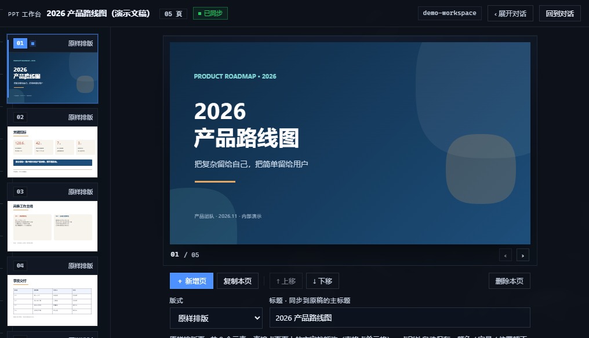
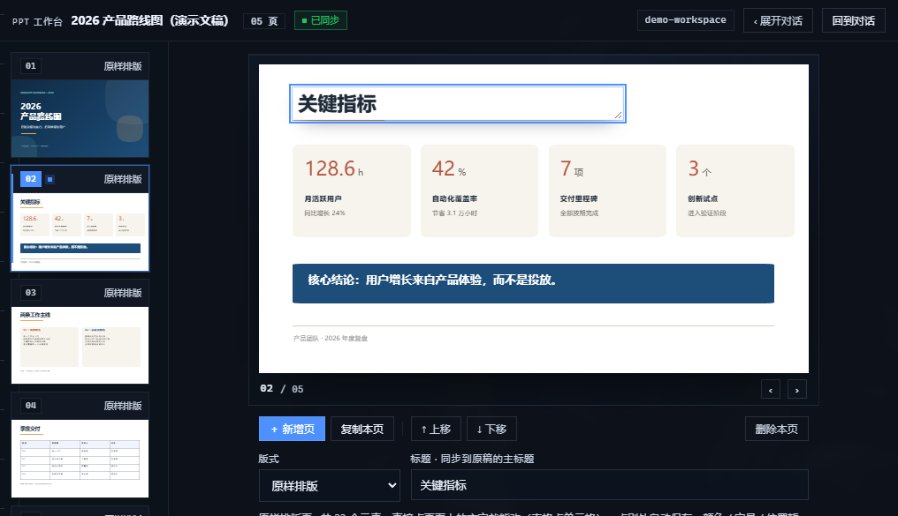
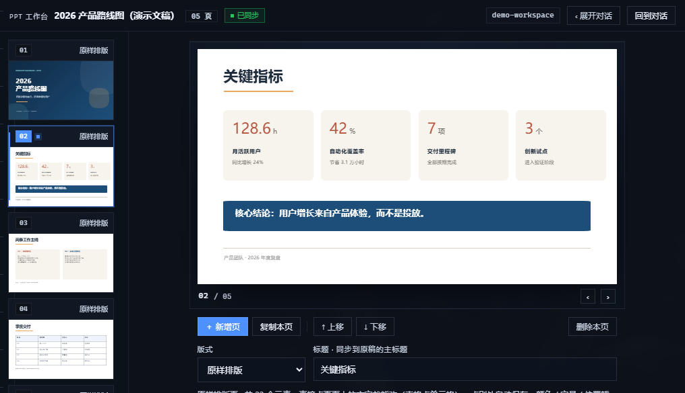
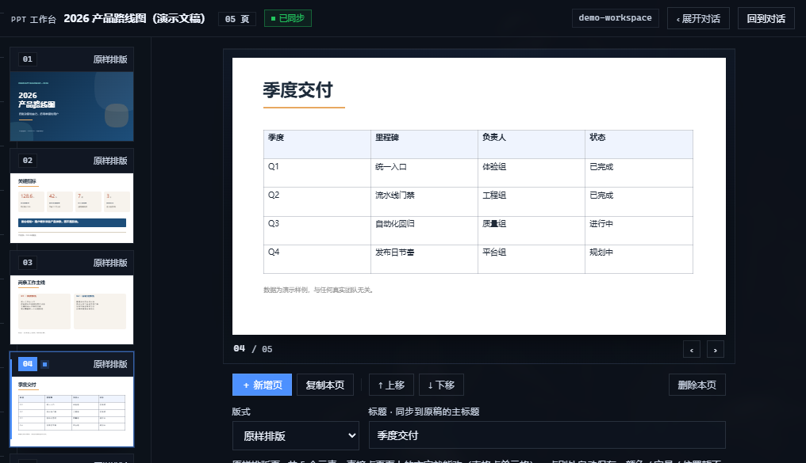
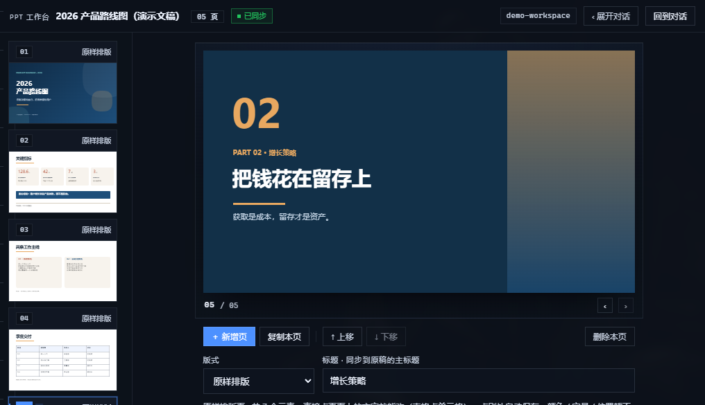

# PPT Studio for DeepSeek Harness

A left-sidebar **PPT workbench** plugin for [DeepSeek Harness](https://github.com/deepseek-ai):
it renders `<workspace>/.ppt-studio/deck.json` as real 16:9 thumbnails, lets you edit the deck
**in place** (click a slide's text, type, click away to save), imports existing `.pptx` files
**as they are** instead of re-flowing them into template layouts, and hosts a continuous AI chat
column that can rewrite the deck for you.



Everything you see above runs on a synthetic demo deck that ships with this repository — no real
presentation content is used in these screenshots.

中文说明见 [README.zh-CN.md](README.zh-CN.md)。

## What it does

- **Live 16:9 preview** — thumbnails and the big preview are real DOM renders of `deck.json`
  (absolute element positions in inches on a 13.333 × 7.5 canvas), not screenshots.
- **Edit the way you see it** — click a text block (or a table cell) right on the slide, type,
  click elsewhere to save. The editor keeps the original font size, weight, alignment and colour.
- **PPTX import, not PPTX re-typesetting** — `/import` runs a python-pptx importer that copies
  every page element by element: absolute geometry, font sizes, colours resolved from theme XML
  (including `lumMod`/`lumOff`/`tint`/`shade`), gradients with per-stop transparency, rounded
  corners and ellipses, pictures deduplicated by content hash, tables, group transforms, and the
  decorations that live on the slide master / layout.
- **Charts and SmartArt never disappear** — pages containing chart, SmartArt or OLE objects are
  rendered wholesale through LibreOffice → PDF → PNG and embedded as one full-bleed image, so
  fidelity is 100% (those pages are read-only by design).
- **AI chat column** — the middle column talks to the current session: Markdown rendering,
  attachments (paste / drag / picker) dropped into `.ppt-studio/inbox`, a live "process" tab
  showing tool calls with durations, and one-click prompts.
- **File watching that respects you** — the panel polls `deck.json`; external edits highlight the
  changed page, but the panel's own saves are never flagged as "AI changed this".
- **One proportional splitter** fills the page and keeps both halves usable at any window size.

### Editing, metrics and imported tables

| | |
|---|---|
|  |  |
| Click any text block (or table cell) and type — click away to save. | Mixed run sizes (`spans`) and rounded shapes survive the PPTX import. |
|  |  |
| Tables are first-class elements, editable cell by cell. | Section pages keep their gradients and typography. |

## Install

The plugin ships as a single tarball with no runtime npm dependencies (the importer needs
Python 3 with `python-pptx`, and optionally LibreOffice + poppler for chart pages).

```bash
dsh plugin --profile web add \
  https://github.com/p8054076283-del/dsh-ppt-studio/releases/latest/download/dsh-ppt-studio.tgz
```

[](https://github.com/p8054076283-del/dsh-ppt-studio/actions/workflows/ci.yml)

Or install the tarball you built locally:

```bash
node build2.mjs && npm pack
dsh plugin --profile web add file:$(pwd)/dsh-ppt-studio-<version>.tgz
```

Restart the app once after the first install. The sidebar then shows **PPT 工作台**.

### Python requirements for `.pptx` import

`python-pptx` and `lxml` are required; `LibreOffice` + `pdftoppm` (poppler) are optional and only
used to rasterize chart/SmartArt pages. The plugin looks for an interpreter in this order:
`DSH_PPT_PYTHON` env var → the runtime bundled with the desktop app → `~/.dsh/dsh-runtimes` →
`python` / `python3` / `py` on `PATH`.

## Quick start

1. Open a workspace that contains a deck (`.ppt-studio/deck.json`), or click **新建示例文稿**.
2. Click any text on the slide to edit it; `Esc` cancels, clicking elsewhere saves.
3. Drop a `.pptx` into the chat column and press **导入** on the attachment chip to replace the
   deck with an element-faithful import.
4. Ask the chat column for changes; it can rewrite `deck.json` directly.

## Deck format (`deck.json`)

```jsonc
{
  "version": 1,
  "theme": { "bg": "#FFFFFF", "fg": "#1F2328", "accent": "#2F6FED", "font": "Microsoft YaHei" },
  "meta": { "title": "Quarterly review" },
  "slides": [
    {
      "id": "s1",
      "layout": "imported",          // imported = keep absolute geometry (no re-layout)
      "title": "Cover",
      "elements": [
        { "type": "shape", "x": 0, "y": 0, "w": 13.333, "h": 7.5,
          "fill": "linear-gradient(90deg, #5E1216 0%, #8F1D22 100%)", "radiusPct": 0 },
        { "type": "image", "x": 8.3, "y": 0, "w": 5, "h": 7.5, "src": "assets/imported/ab12cd34ef.png", "fit": "cover" },
        { "type": "text", "x": 0.8, "y": 2.6, "w": 6, "h": 1.6, "text": "Hello\nworld",
          "size": 40, "color": "#FFFFFF", "bold": true, "align": "left", "valign": "top",
          "nowrap": true, "spans": [{ "t": "24", "size": 40 }, { "t": " pts", "size": 16 }] },
        { "type": "table", "x": 1, "y": 4, "w": 6, "h": 2,
          "columns": ["A", "B"], "rows": [["1", "2"]], "size": 14 }
      ]
    }
  ]
}
```

Coordinates are inches on a 13.333 × 7.5 canvas; the renderer converts them to percentage
positions and font sizes to `cqw`, so a slide scales exactly with its container.

## Architecture

```
lib/index.js         host half — HTTP routes under /ppt-studio (loopback only)
lib/client.js        client half — built artifact loaded by the Harness slot system
src/bundle/*.js      panel, chat, markdown, styles, registration (source of the client half)
src/client/render.js deck validation + slide renderer (shared by bundle and tests)
scripts/import-pptx.py      PPTX → deck.json importer (python-pptx + lxml)
scripts/selftest-*.mjs/.py  self-tests (no browser needed)
build2.mjs           builds lib/client.js from src/bundle + src/client
```

Host routes: `/health`, `/state`, `/session`, `/sessions`, `/answer`, `/cancel`, `/report`,
`/diag`, `/upload`, `/import`, `/deck` (PUT), `/asset` (GET). They refuse non-loopback peers and
resolve every workspace path through the same guard as the rest of the panel.

The client half registers two slots: a `sidebar.panellist` entry (id `ppt-studio`) and a `main`
page (key `ppt-studio`). It talks to the host half over the routes above and to the session
through the Harness session binding.

## Development

```bash
node build2.mjs                 # rebuild lib/client.js, then install the packed tarball
node scripts/selftest-client.mjs    # client bundle pre-flight (jsdom-free, structural)
node scripts/selftest-host.mjs      # host routes
node scripts/selftest-render.mjs    # deck validation + renderer
node scripts/selftest-markdown.mjs  # markdown renderer
python scripts/selftest-import.py   # importer (+ rasterization when LibreOffice/poppler exist)
```

`dev-live-*.mjs` scripts drive a running desktop app over the Chrome DevTools Protocol
(port 9222) for visual checks; they expect a Chinese Windows workspace and are development-only.

## Known limitations

- No shadows, glows, 3-D, rotation, WordArt or animations — shapes are drawn as rectangles,
  rounded rectangles, ellipses or gradients.
- One text box can hold mixed run styles (`spans`), but editing a box in place flattens it to the
  base style.
- 4:3 decks are scaled into the 16:9 canvas.
- Chart / SmartArt / OLE pages are images (read-only).
- Re-importing a `.pptx` overwrites in-panel edits, because the source of truth is the file.

## License

MIT — see [LICENSE](LICENSE).
